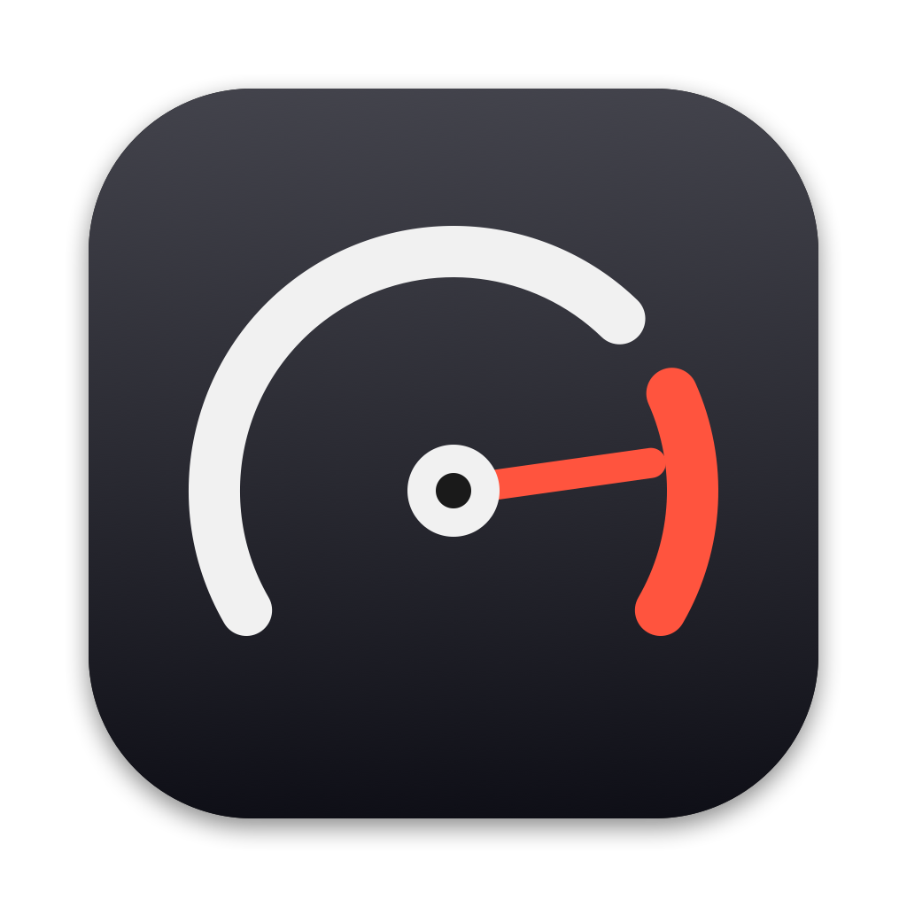

<p align="center">
  
</p>

<h1 align="center">Redline</h1>

<p align="center">
  A free, open-source performance overlay for Apple Silicon Macs.<br>
  See FPS, CPU, GPU, RAM and temperature on top of any game.
</p>

---

## Features

- **FPS for any Metal game**: App Store, Steam, iPhone/iPad games on Mac, and your own builds, with a 60-second FPS graph
- **The game itself**: its own CPU and memory use, not just the whole Mac's
- **Chip**: CPU and GPU temperatures, power draw (watts), clock speeds, thermal state
- **Memory**: RAM, memory pressure and swap, the usual causes of stutters
- **Battery**: charge and drain in watts
- **Compact or Full overlay**: just the essentials, or everything above
- **Session summary** when you close a game: average FPS, worst 1% low, stutters, max temperature, peak power and memory
- **Record sessions**: one CSV log and summary saved for every game you play, no Terminal needed
- **Overlay in any corner**: transparent, click-through, stays on top of full-screen games
- **No permissions needed**: no Screen Recording, no Accessibility
- **Menu bar app**: no Dock icon, open settings anywhere with **⌃⌥R**
- **Developer mode**: exact, uncapped FPS and CSV logs for your own Unity/Metal builds

## Requirements

- Mac with Apple Silicon (M1 or newer)
- macOS 14 Sonoma or newer
- An administrator account (needed to read FPS; other stats work on any account)

## Install

1. Download the latest `Redline-x.y.z.dmg` from [Releases](https://github.com/thihanhein20/redline/releases).
2. Open the DMG and drag **Redline** onto **Applications**.
3. Open Redline. macOS will show:

   > *"Redline" Not Opened. Apple could not verify "Redline" is free of malware…*

   This happens because Redline isn't signed with a paid Apple Developer ID. The source code is all here if you want to check it. Click **Done** (not *Move to Trash*).
4. Open **System Settings → Privacy & Security**, scroll down to *"Redline" was blocked…* and click **Open Anyway**. Enter your password.

You only need to do this once.

<details>
<summary>Prefer Terminal?</summary>

After step 2, this removes the "downloaded from the internet" flag so macOS opens it directly:

```bash
xattr -dr com.apple.quarantine /Applications/Redline.app
```
</details>

## How to use

1. **Open Redline first**, then open your game. Games that were already running need a restart.
2. The overlay appears in the top-left corner and shows FPS a few seconds after the game starts.
3. Press **⌃⌥R** (Control + Option + R) or click the gauge icon in the menu bar to:
   - show or hide the overlay
   - move it to another corner
   - switch between **Compact** and **Full**
   - turn on **Record sessions** to save a CSV and summary for every game (in `~/Library/Logs/Redline/`, open it with **Show Logs in Finder**)
   - see the **last session** summary
   - send feedback or report an issue
   - quit Redline

Press **⌃⌥O** to show or hide the overlay (handy for screenshots), and **⌃⌥M** to drop a **marker** (for example "boss fight starts"). It flashes on the overlay and is saved in the CSV log.

Redline gets FPS from Apple's built-in Metal Performance HUD, running hidden in the background, so nothing extra is drawn in your game. It's switched off again when you quit Redline.

> **Can't see the menu bar icon?** On MacBooks with a notch, a crowded menu bar can hide it behind the notch. Use **⌃⌥R** instead, or hold **⌘** and drag other menu bar icons to make room.

## For developers: exact FPS and CSV logs

Testing your own Unity or Metal build? Run it through Redline to count every frame directly, with no screen refresh cap, and log the stats to a CSV file.

Launched this way, Redline also measures frame pacing:

- **1% low FPS**: average FPS of the slowest 1% of frames, the standard stutter number
- **Stutters**: frames that took more than twice as long as a typical frame
- **Frame-time graph**: every frame of the last ~2 seconds; spikes are hitches
- **GPU time per frame**: tells you whether slow frames are GPU-bound

### Terminal (preview)

> **Preview:** the Terminal command is new and still being tested. Please [report anything that doesn't work](https://github.com/thihanhein20/redline/issues/new?labels=bug).

1. In Redline's settings (**⌃⌥R**), click **Install Terminal Command** and enter your Mac password.
2. From your project folder:

```bash
redline run ./Builds/MyGame.app > run.csv
```

- Logs one CSV row per second with every stat Redline measures (FPS, 1% low, stutters, GPU time, the game's CPU and memory, temperatures, power, clocks, battery, markers…)
- The game's own output and the session summary go to the Terminal (stderr), so the CSV stays clean
- Arguments after the app path go to the game, for example `-screen-fullscreen 0`
- Redline quits when the game exits

Compare two runs, for example before and after an optimisation:

```bash
redline compare before.csv after.csv
```

```
                    before     after           Change
Average FPS           57.1      60.0     +5.1% better
Average 1% low         7.6      25.4   +234.7% better
Stutters                 4         0   -100.0% better
Average power        4.5 W     3.5 W    -22.9% better
```

### Unity Editor

Install the Redline package: **Window → Package Manager → + → Add package from git URL…**

```
https://github.com/thihanhein20/redline.git?path=/Unity/com.hanindustries.redline
```

Then use the new **Redline** menu:

- **Build and Run with Redline**: makes a macOS development build in `Builds/Redline/` and runs it through Redline
- **Run Last Build with Redline**: runs it again without rebuilding
- **Open Logs Folder**: one CSV per run in `Builds/Redline/Logs/`, plus a `.txt` with the game's output and the session summary

> Works only for builds **without** Hardened Runtime (Unity development builds are fine). Steam/App Store games and iPhone/iPad apps can't be launched this way; open them normally instead.

## How it works

| Stat | Source |
|---|---|
| FPS (any game) | Apple's Metal Performance HUD, which Redline turns on (hidden) while running and reads from the system log |
| FPS (`redline run`) | a small library loaded into your game that counts each frame it draws |
| Frame pacing, GPU time (`redline run`) | per-frame timestamps from that library, and Apple's HUD output from the game |
| CPU | per-core CPU time from the macOS kernel |
| GPU | GPU driver utilisation statistics |
| Game CPU and memory | the game process's CPU time and memory footprint (same as Activity Monitor) |
| RAM, pressure, swap | Activity Monitor's formulas and macOS memory pressure |
| CPU and GPU temperature | the Mac's SMC sensors (the same ones Stats and iStat Menus read) |
| Power and clock speeds | Apple's IOReport energy and performance-state counters (the same source as `powermetrics`, without sudo) |
| Battery | the battery driver's charge, current and voltage |

Redline makes no network requests and collects no data.

## Build from source

Needs Xcode 26 (Swift 6.2).

```bash
git clone https://github.com/thihanhein20/redline.git
cd redline
swift build && swift test
scripts/build-app.sh     # → build/Redline.app
scripts/make-dmg.sh      # → build/Redline-x.y.z.dmg
```

## Known limitations

- Clock speeds are read on M1 and M2 chips; on other chips those rows are hidden.
- Frame pacing (1% low, stutters, frame-time graph, GPU time) needs `redline run`; for other games macOS only reports FPS about once a second.
- Some games capture the whole keyboard, so **⌃⌥R** may not work inside them. Use the menu bar icon instead.

## Feedback

- **Ideas or feedback:** use **Send Feedback** in Redline's settings, or fill in the [feedback form](https://forms.gle/Gi6vb9GKv4Ars1xc8). No account needed.
- **Bugs:** use **Report an Issue** in Redline's settings, or [open an issue](https://github.com/thihanhein20/redline/issues) on GitHub. Your Mac details are filled in for you.

## Contributing

Pull requests are welcome! See [CONTRIBUTING.md](CONTRIBUTING.md) for setup, code guidelines and how to open a PR.

## License

Redline is open source under the [MIT License](LICENSE).

---

<p align="center">Developed by <a href="https://www.hanindustries.net/">Han Industries</a></p>
